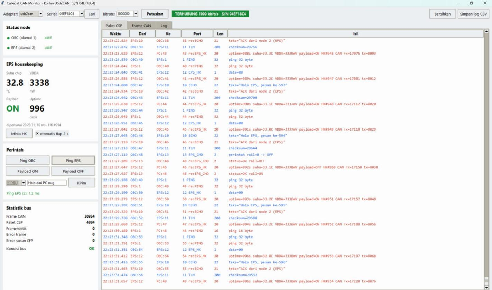
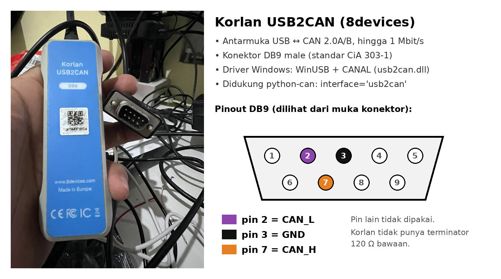
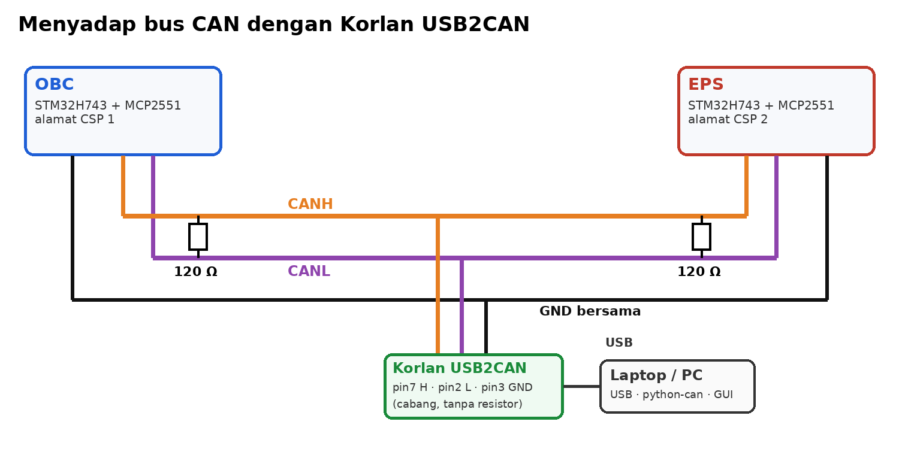
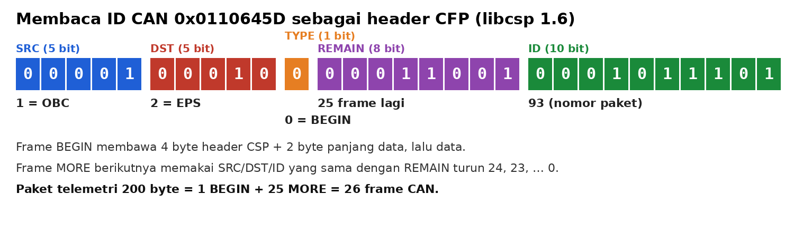
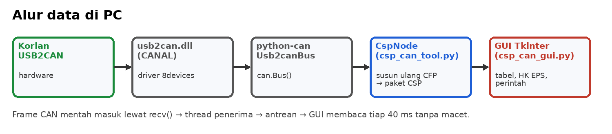
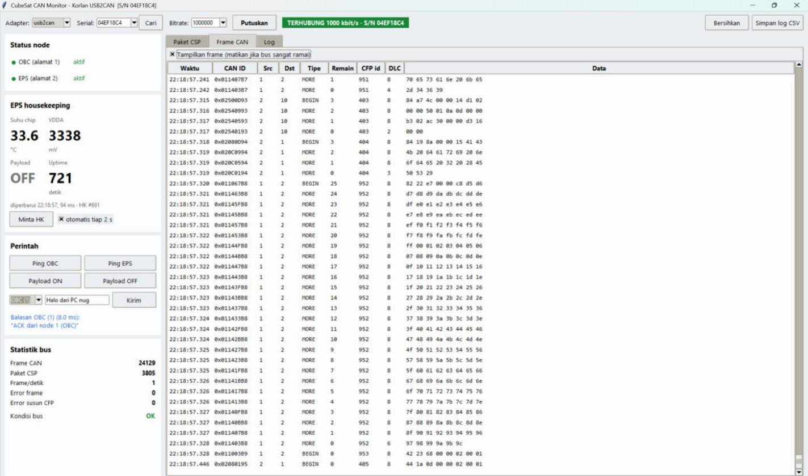
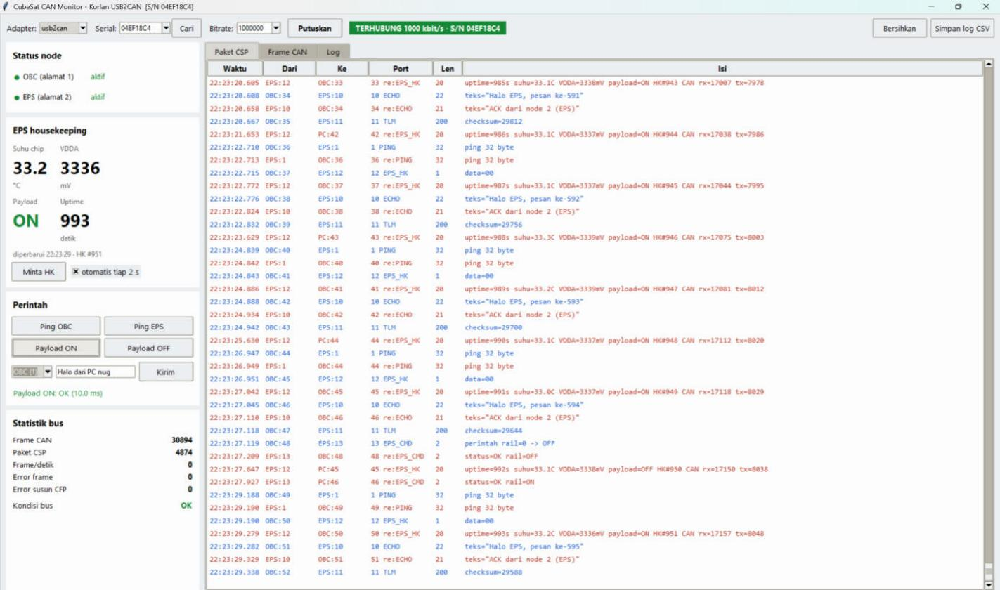
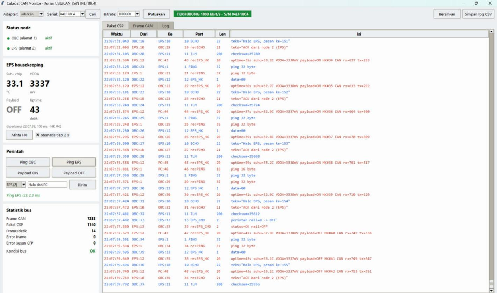
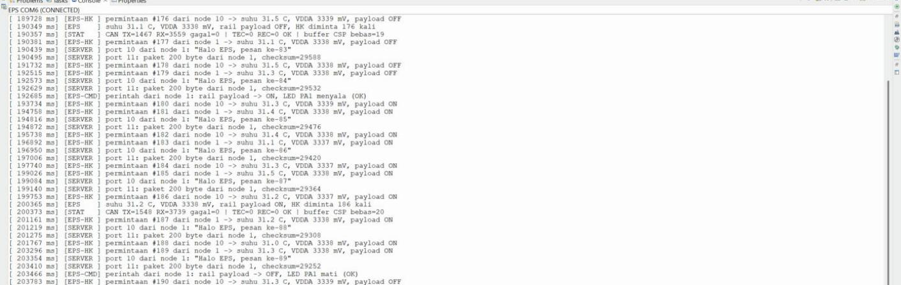
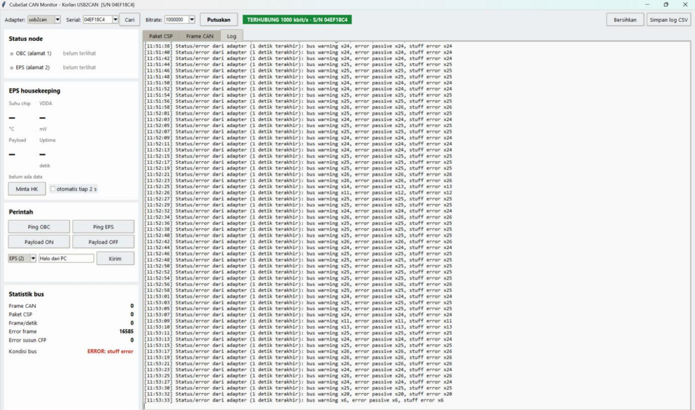

[English](README.en.md) | **Bahasa Indonesia**

# CubeSat CAN Sniffer (libcsp) – Korlan USB2CAN + GUI Python

Kode pendamping tutorial **"Sniffing CAN Bus CubeSat (libcsp) dengan Korlan USB2CAN dan GUI Python"**: https://nugrohowidijatmiko.blogspot.com/2026/10/sniffing-can-bus-cubesat-libcsp-dengan.html

Korlan USB2CAN (8devices) dipasang sebagai "telinga" ketiga di bus CAN antara dua board STM32H743 (OBC dan EPS) yang berkomunikasi dengan CubeSat Space Protocol (libcsp 1.6). Program Python ini menampilkan frame CAN mentah, menyusun ulang frame menjadi paket CSP, menampilkan data housekeeping EPS, dan bisa mengirim perintah (ping, payload ON/OFF, pesan) langsung dari laptop.



*Tab Paket CSP dengan Korlan asli: biru = OBC, merah = EPS. Panel kiri menampilkan housekeeping EPS dan hasil Ping EPS.*

## Isi repositori

| File | Fungsi |
|---|---|
| `csp_can_tool.py` | Library CFP/CSP + alat command line: `list`, `monitor`, `ping`, `hk`, `payload`, `echo` |
| `csp_can_gui.py` | GUI Tkinter: tabel paket CSP, tabel frame CAN, panel housekeeping EPS, tombol perintah, statistik bus, simpan log CSV, plus mode simulasi tanpa hardware |
| `test_korlan.py` | Tes koneksi singkat: cari Korlan lalu tampilkan frame selama 5 detik |
| `docs/` | Diagram dan tangkapan layar dari tutorial |
| [`canable/`](canable/) | Versi untuk **Makerbase CANable V2.0 Pro** (firmware slcan, tanpa driver/DLL) |

> **Punya Makerbase CANable V2.0 Pro?** Pakai kode di folder [`canable/`](canable/). Langkah dan perbedaannya ada di [canable/README.md](canable/README.md).

## Perangkat

| Perangkat | Keterangan |
|---|---|
| Korlan USB2CAN (8devices) | Adapter USB ke CAN, konektor DB9 |
| 2 board STM32H743 (DevEBox) + modul MCP2551 | OBC dan EPS dari tutorial sebelumnya |
| 2 resistor 120 Ω | Terminator di kedua ujung bus |
| Konektor DB9 female / adaptor terminal sekrup | Untuk menyambung kabel ke Korlan |
| Laptop Windows + Python 3 (64-bit) | python-can, pywin32, Tkinter |



## Langkah singkat

1. **Driver dan DLL.** Dari halaman produk 8devices Korlan USB2CAN (bagian *Resources*), pasang `usb2can_winusb.msi`, lalu salin `x64/Release/usb2can.dll` dari *USB2CAN CANAL DLL v2.0.0* ke folder repo ini. DLL x64 untuk Python 64-bit.
2. **Library Python.**
   ```bash
   pip install python-can pywin32
   ```
3. **Sambungkan Korlan ke bus** secara paralel di tengah bus: DB9 pin 7 = CANH, pin 2 = CANL, pin 3 = GND. Pasang terminator 120 Ω di kedua ujung (bukan di Korlan). Saat semua board mati, hambatan CANH–CANL harus sekitar 60 Ω.

   
4. **Tes koneksi** (ganti serial number dengan milik Anda):
   ```bash
   python test_korlan.py
   ```
5. **Jalankan GUI.**
   ```bash
   python csp_can_gui.py
   ```
   Pilih *Adapter* `usb2can` (atau `simulasi` untuk mencoba tanpa hardware), lalu klik **Hubungkan**. Serial number Korlan dicari otomatis; tombol **Cari** mencari ulang.

### Tanpa GUI

```bash
python csp_can_tool.py list
python csp_can_tool.py monitor --frames
python csp_can_tool.py ping 2
python csp_can_tool.py hk
python csp_can_tool.py payload on
python csp_can_tool.py echo 1 "Halo OBC"
```

Opsi umum: `--interface` (default `usb2can`, bisa `virtual`), `--channel` (serial number Korlan), `--bitrate` (default 1000000), `--timeout`.

## Cara kerja

libcsp mengirim paket CSP lewat CAN memakai **CFP (CAN Fragmentation Protocol)**. Alamat ada di ID extended 29-bit: `[SRC 5][DST 5][TYPE 1][REMAIN 8][ID 10]`. Contoh ID `0x0110645D`: dari OBC (1) ke EPS (2), frame BEGIN, masih 25 frame lagi, paket nomor 93.



`CfpReassembler` meniru `csp_can_rx()` di libcsp: frame dikelompokkan per (SRC, DST, ID), frame BEGIN membuka buffer, frame MORE ditambahkan selama REMAIN turun berurutan, dan paket selesai saat jumlah byte sama dengan panjang di header.

Thread penerima membaca `bus.recv()` terus-menerus dan memasukkan hasilnya ke antrean. GUI mengambil antrean setiap 40 ms (maksimal 500 item sekali ambil), sehingga jendela tetap responsif walau bus ramai.



Konstanta di `csp_can_tool.py` (alamat OBC = 1, EPS = 2, PC = 10; port PING 1, ECHO 10, TLM 11, EPS_HK 12, EPS_CMD 13; format `eps_hk_t`) harus sama dengan firmware (`cubesat_proto.h`).

## Tampilan GUI

**Tab Frame CAN**: setiap frame dengan ID yang sudah diuraikan (Src, Dst, BEGIN/MORE, Remain, CFP id). Telemetri 200 byte = 26 frame (BEGIN remain=25, lalu MORE 24…0).



**Hasil uji dengan hardware asli** (Korlan, 1 Mbit/s): kedua node aktif, kondisi bus OK, error frame 0. Payload ON dari laptop dijawab EPS dalam ±10 ms.





**Log serial EPS** (USART1, 115200 baud) untuk memastikan apa yang terlihat di Korlan memang diterima EPS:



## Troubleshooting

Kalau sinyal bus rusak, Korlan mengirim pesan status/error (byte data pertama). GUI meringkasnya per detik di tab Log dan baris **Kondisi bus**. Contoh saat bus belum diberi terminator:



| Gejala | Kemungkinan penyebab | Solusi |
|---|---|---|
| Frame CAN = 0, tidak ada error | Korlan belum tersambung ke bus / node tidak mengirim | Cek kabel DB9 (pin 7, 2, 3), pastikan board menyala |
| Banyak stuff error, bus warning, error passive | Tanpa terminator 120 Ω, CANH/CANL tertukar, atau bitrate berbeda | Pasang 2×120 Ω (ukur ±60 Ω), cek CANH–CANH, samakan bitrate |
| Hanya ACK error | Tidak ada node lain yang membalas | Nyalakan node lain (Korlan sendiri juga memberi ACK) |
| Error terus walau kabel benar | MCP2551 dicatu 5 V butuh TXD ≥ 3,5 V, STM32 hanya 3,3 V | Pakai transceiver 3,3 V (SN65HVD230) atau pull-up 2,2 kΩ CTX ke 5 V + PA12 open-drain |
| "DLL failed to load" | `usb2can.dll` tidak ada / beda arsitektur | Salin DLL x64 ke folder program, pakai Python 64-bit |

Korlan ikut memberi ACK di bus, jadi satu board saja bersama Korlan tetap terbaca. Ini cara cepat menguji OBC dan EPS satu per satu.

## Catatan

- `usb2can.dll` tidak disertakan di repo ini; unduh dari 8devices.
- Mode `simulasi` di GUI membuat OBC dan EPS tiruan di bus virtual python-can, perilakunya sama dengan firmware.

## Lisensi

Kode di repositori ini dirilis dengan lisensi [MIT](LICENSE).
